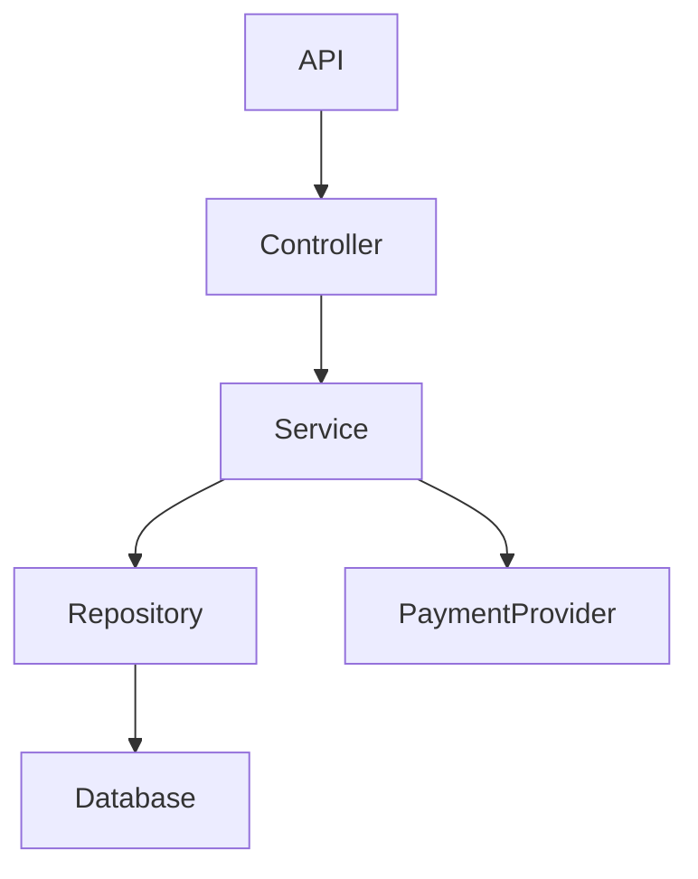

RepoSense --- AI Codebase Intelligence Engine
CONTINUATION PROJECT PLAN --- CURRENT STATE AWARE
Document purpose: This is the authoritative continuation plan for
Antigravity.
Important: RepoSense is already substantially implemented through
Phase 5, with Phase 6 currently in progress. Do not restart, rebuild,
or replace completed work. Continue from the actual repository state
described below, verify it against the codebase, and work strictly
phase-by-phase.

1. CURRENT PROJECT STATE --- AUTHORITATIVE CONTEXT
Current Phase
PHASE 6
Current Status
COMPLETE
Completed Phases
- Phase 0 — Foundation
- Phase 1 — Repository Ingestion
- Phase 2 — Static Analysis
- Phase 3 — Symbol Index
- Phase 4 — Embeddings / Vector Storage
- Phase 5 — Knowledge Graph
- Phase 6 — Hybrid Retrieval + ContextBuilder
Current Task
Phase 6 locked and verified. Proceeding to Phase 7 (Persistent Knowledge Graph).
Existing Completed Work
- [x] Initial FastAPI backend
- [x] SQLite vector and symbol storage
- [x] Basic in-memory NetworkX Knowledge Graph
- [x] Next.js 16 frontend migration and redesign
- [x] Basic Gemini 3.8-flash reasoning
- [x] GitHub repository ingestion
- [x] Python AST-based symbol extraction
- [x] Repository metadata indexing
- [x] Semantic vector retrieval
- [x] Graph expansion during querying
- [x] Gemini-grounded query pipeline
- [x] Hybrid Keyword & Semantic ContextBuilder
- [x] Deterministic relevance ranking & context budgeting
Known Test Issue
None. Resolved pytest execution-path configuration via pyproject.toml pythonpath.
Known Technical Debt
1. Graph is currently rebuilt dynamically on query (Target of Phase 7).
2. JavaScript/TypeScript parser exists but is not integrated into the
   main ingestion loop (Target of Phase 8).
3. Frontend Phase 16 is marked IN_PROGRESS, but Phase 6–15 backend
   intelligence work takes priority unless the current repository shows
   a concrete frontend blocker.
Blockers
None
Last Verified
2026-10-12
Last Git Commit
6defab3
GitHub Push Status
PUSHED

2. PHASE CHECKPOINT STATE
  Phase   Status          Commit      GitHub
  0       COMPLETE        4a86851   PUSHED
  1       COMPLETE        8fce635   PUSHED
  2       COMPLETE        43e35b6   PUSHED
  3       COMPLETE        9edd7ea   PUSHED
  4       COMPLETE        17a4b05   PUSHED
  5       COMPLETE        624239a   PUSHED
  6       COMPLETE        6defab3   PUSHED
  7       IN_PROGRESS     —         —
  8       NOT_STARTED     ---         ---
  9       NOT_STARTED     ---         ---
  10      NOT_STARTED     ---         ---
  11      NOT_STARTED     ---         ---
  12      NOT_STARTED     ---         ---
  13      NOT_STARTED     ---         ---
  14      NOT_STARTED     ---         ---
  15      NOT_STARTED     ---         ---
  16      IN_PROGRESS*   ---         ---
  17      NOT_STARTED     ---         ---
* Phase 16 may contain existing frontend work. Do not assume it is
complete merely because it is marked IN_PROGRESS. Inspect it.
3. PRODUCT VISION
RepoSense is an AI-powered codebase intelligence engine.
It should understand a software repository structurally and
semantically, then allow developers to:
- search the codebase
- ask repository-grounded questions
- trace execution paths
- understand architecture
- inspect dependencies
- analyze change impact
- debug repository-specific problems
- generate repository-grounded documentation
The final product is NOT:
"ChatGPT for GitHub."

The final product is:
"A codebase intelligence engine that understands how my software
actually works."

The differentiating architecture is:
STATIC CODE UNDERSTANDING
        +
CODE KNOWLEDGE GRAPH
        +
HYBRID RETRIEVAL
        +
GROUNDED GEMINI REASONING
        =
REPOSITORY INTELLIGENCE
The LLM is the reasoning layer, not the source of repository truth.
4. EXISTING ARCHITECTURE
The current system approximately follows:
GitHub Repository
        ↓
Repository Ingestion
        ↓
Python AST Parsing
        ↓
Symbol Extraction
        ↓
SQLite Symbol Storage
        ↓
Embedding Generation
        ↓
Vector Storage
        ↓
NetworkX Knowledge Graph
        ↓
Semantic Retrieval
        ↓
Graph Expansion
        ↓
Gemini
        ↓
Source-backed Answer
This is a valid foundation.
Do not replace this architecture unnecessarily.
The objective is to strengthen it and add intelligence layers on top.
5. NON-NEGOTIABLE DEVELOPMENT RULES
Rule 1 --- Inspect Before Coding
Before doing any implementation in the current session:
1. Read README.md.
2. Read PROJECT_STATE.md.
3. Inspect the current Git status.
4. Inspect recent commits.
5. Inspect backend structure.
6. Inspect frontend structure.
7. Inspect parser modules.
8. Inspect indexing modules.
9. Inspect vector modules.
10. Inspect graph modules.
11. Inspect query engine.
12. Inspect Gemini integration.
13. Inspect API routes.
14. Inspect database models.
15. Inspect tests.
16. Run the current tests.
17. Verify the current backend.
18. Verify the current frontend.
Do not rely solely on this document.
The actual repository is the implementation source of truth.
Rule 2 --- Do Not Rebuild Completed Phases
Phases 0--5 are marked COMPLETE.
Do not redo them unless an actual regression or blocker is discovered.
If an improvement is required, make the smallest safe change.
Rule 3 --- One Phase at a Time
The only phase currently authorized for implementation is:
PHASE 6
Do not begin Phase 7 until Phase 6 passes its complete checkpoint.
After Phase 6:
Phase 7
→ Phase 8
→ Phase 9
→ Phase 10
→ Phase 11
→ Phase 12
→ Phase 13
→ Phase 14
→ Phase 15
→ Phase 16
→ Phase 17
Only advance sequentially.
Rule 4 --- No Fake Completion
Never mark a feature complete if it is:
- mocked
- hardcoded
- placeholder-only
- manually tailored to one example
- backend-only
- frontend-only
- returning fabricated repository facts
Every feature must work end-to-end.
Rule 5 --- Do Not Break Existing APIs
Before modifying an API:
- inspect callers
- inspect frontend usage
- inspect tests
- preserve compatibility where possible
If an API contract must change, update all consumers and tests in the
same phase.
Rule 6 --- Static Analysis Is Ground Truth
Use:
- Python AST
- Tree-sitter
- symbol index
- repository metadata
- dependency graph
- call graph
- source code
for repository facts.
Gemini should explain and reason over evidence.
Rule 7 --- No Repository Hallucinations
Never instruct Gemini to "use intuition" when evidence is sparse.
Correct behavior:
Evidence sufficient
    ↓
Answer with citations

Evidence insufficient
    ↓
State that evidence is insufficient
    ↓
Do not invent repository facts
Never invent:
- files
- symbols
- APIs
- dependencies
- execution paths
- database operations
- architecture
Rule 8 --- Security
Repositories are untrusted.
Do not automatically execute repository code.
Do not automatically run:
- npm install
- arbitrary npm scripts
- shell scripts
- setup.py
- Makefiles
- arbitrary Python programs
- postinstall scripts
- repository executables
Static analysis must work without arbitrary code execution.
Rule 9 --- Free First
Prefer free/open-source tooling where practical.
Current Gemini integration may remain.
Do not add paid infrastructure without a concrete reason.
Do not add technology simply to make the stack look impressive.
6. PHASE 6 --- CURRENT PRIORITY
Objective
Complete Hybrid Retrieval + ContextBuilder.
The current system relies primarily on vector similarity.
Target:
                         USER QUERY
                             │
              ┌──────────────┼──────────────┐
              ▼              ▼              ▼
         Semantic        Keyword         Symbol/
         Retrieval       Retrieval       Path Search
              │              │              │
              └──────────────┼──────────────┘
                             ▼
                       Candidate Pool
                             │
                             ▼
                      Graph Expansion
                             │
                             ▼
                         Reranking
                             │
                             ▼
                      Context Builder
                             │
                             ▼
                           Gemini
                             │
                             ▼
                   Grounded Repository Answer
Phase 6 requirements
Implement or strengthen:
6.1 Semantic Retrieval
Keep the existing embedding search.
Do not remove it.
6.2 Exact Symbol Retrieval
If a user asks:
Where is PaymentService implemented?
exact or near-exact symbol matching should strongly influence ranking.
6.3 Filename / Path Retrieval
Queries such as:
What is in auth_service.py?
should be able to retrieve the correct file even if its semantic
embedding is not ideal.
6.4 Keyword Retrieval
Support meaningful lexical matching over:
- symbol names
- file paths
- class names
- function names
- code content
- docstrings
6.5 Graph Expansion
After retrieving primary candidates:
Primary Symbols
      ↓
CALLS
IMPORTS
USES
REFERENCES
INHERITS
expand the candidate context.
Do not indiscriminately include the entire graph.
6.6 Deduplication
The same symbol/file should not appear repeatedly because it was
discovered through multiple retrieval strategies.
6.7 Relevance Ranking
Create a deterministic or explainable ranking mechanism.
Possible conceptual score:
final_score =
    semantic_score
    +
keyword_score
    +
symbol_match_score
    +
path_match_score
    +
graph_relevance_score
The exact formula should be determined from the existing architecture.
Do not invent arbitrary weights without testing.
7. CONTEXTBUILDER
Create a dedicated abstraction responsible for preparing repository
evidence for Gemini.
Conceptual interface:
ContextBuilder
    ├── select_primary_symbols()
    ├── expand_graph_context()
    ├── rank_evidence()
    ├── deduplicate()
    ├── enforce_context_budget()
    └── build_llm_context()
The ContextBuilder should:
- accept retrieval candidates
- rank them
- remove duplicates
- preserve source metadata
- include graph relationships
- enforce a bounded context size
- produce structured evidence
- prepare grounded Gemini context
Do NOT send the entire repository to Gemini.
Do NOT send arbitrary massive graph dumps.
8. GROUNDED GEMINI BEHAVIOR
The Gemini prompt should enforce:
You are RepoSense's repository analysis engine.

Answer only using repository evidence supplied in the context.

Never invent:
- files
- symbols
- dependencies
- APIs
- execution paths
- database operations
- architecture

For every important repository-specific claim, provide a source reference.

If evidence is insufficient:
- state that clearly
- explain what was found
- do not speculate
The system should prefer:
"I cannot establish this from the indexed repository."
over a hallucinated answer.
9. PHASE 6 ACCEPTANCE CRITERIA
Phase 6 is complete only when:
- semantic retrieval still works
- exact symbol matching works
- path/file matching works
- keyword retrieval works
- graph expansion works
- duplicate evidence is removed
- relevance ranking works
- ContextBuilder exists as a reusable abstraction
- Gemini receives bounded structured context
- existing Q&A continues working
- existing API contracts remain functional
- existing tests pass
- new retrieval tests pass
- integration tests pass
- manual queries have been verified
- documentation is updated
- PROJECT_STATE.md is updated
- Git commit is created
- Git push succeeds
- remote branch is verified
- working tree is clean
Suggested benchmark
Create at least 20 controlled questions.
Measure:
- Recall@5
- evidence relevance
- citation correctness
- answer correctness
Do not fabricate results.
10. PHASE 6 GIT CHECKPOINT
After all verification:
git status
git diff
git add .
git commit -m "phase-06: implement hybrid retrieval and context builder"
git push
git status
Verify:
- branch is up to date
- working tree is clean
- commit exists remotely
Only then update:
Phase 6 = COMPLETE
and:
Next Allowed Phase = Phase 7
11. PHASE 7 --- PERSISTENT KNOWLEDGE GRAPH
Once Phase 6 is complete, address the known technical debt:
Graph is rebuilt dynamically on query.

Current problem:
Query
 ↓
Load every symbol
 ↓
Rebuild NetworkX graph
 ↓
Query graph
Target:
During ingestion
Repository
 ↓
Parse
 ↓
Extract symbols
 ↓
Extract relationships
 ↓
Build graph
 ↓
Persist/index graph
 ↓
Repository ready
During querying
Question
 ↓
Retrieve candidates
 ↓
Query existing graph
 ↓
Expand relationships
 ↓
Build context
 ↓
Gemini
11.1 Graph node types
Target:
- repository
- file
- module
- class
- function
- method
- API endpoint where detectable
- database model where detectable
11.2 Graph relationships
Target:
IMPORTS
DEFINES
CALLS
INHERITS
USES
REFERENCES
CONTAINS
IMPLEMENTS
EXPOSES
Only create relationships supported by evidence.
11.3 Acceptance criteria
- graph generated during ingestion
- graph can be queried without full rebuild
- graph survives server restart
- graph can be inspected
- re-ingestion updates graph
- existing Q&A still works
- graph-related tests pass
Commit:
phase-07: persist repository knowledge graph
Push and verify.
12. PHASE 8 --- MULTI-LANGUAGE STATIC ANALYSIS
Known issue:
JS/TS parser exists but is not integrated into the main loop.

MVP target:
Python
JavaScript
TypeScript
Keep Python AST.
Integrate Tree-sitter-based JavaScript/TypeScript analysis into the
actual ingestion pipeline.
Recommended conceptual structure:
parsers/
    base.py
    python_parser.py
    javascript_parser.py
    typescript_parser.py
Common symbol representation:
Symbol
    id
    repository_id
    name
    type
    language
    file_path
    start_line
    end_line
    signature
    docstring
    content
    metadata
Extract where practical:
- functions
- classes
- methods
- imports
- calls
- inheritance
- interfaces/types
- references
Do not break Python support.
Create fixture repositories for:
- Python
- JavaScript
- TypeScript
Target:
>=90% structural extraction accuracy on a manually verified
controlled sample for supported constructs.
Commit:
phase-08: integrate JavaScript and TypeScript static analysis
13. PHASE 9 --- EXECUTION FLOW TRACING
This is one of the primary RepoSense differentiators.
Example query:
What happens when a user creates an order?

Expected conceptual result:
POST /api/orders
        ↓
OrderController.create()
        ↓
OrderService.create_order()
        ↓
PaymentService.process_payment()
        ↓
InventoryService.reserve()
        ↓
OrderRepository.save()
        ↓
Database
Each step should include:
- symbol
- file
- line number
- relationship
- evidence
Structured model:
ExecutionTrace
    entrypoint
    steps[]
    confidence
    unresolved_steps[]
Important:
The graph determines the path. Gemini explains the path.
Do not let Gemini invent execution paths.
If multiple valid paths exist:
- show alternatives
- identify uncertainty
If the path cannot be established:
- state that clearly
Target:
>=80% major-path accuracy across 5 controlled workflows.
Commit:
phase-09: implement execution flow tracing
14. PHASE 10 --- ARCHITECTURE INTELLIGENCE
Use the existing repository graph.
Detect, where evidence allows:
- frontend
- backend
- API
- controllers
- services
- repositories
- databases
- external services
- major modules
Generate Mermaid from actual relationships.
Example:

No hardcoded fake architecture.
Frontend should allow:
- zoom
- filtering
- component selection
- relationship inspection
- source navigation
Commit:
phase-10: add architecture intelligence and diagrams
15. PHASE 11 --- CHANGE IMPACT ANALYSIS
Question:
What will be affected if I modify PaymentService.process_payment()?

Use reverse graph traversal:
Changed Symbol
      ↓
Direct Callers
      ↓
Indirect Callers
      ↓
Dependent Modules
      ↓
Affected Tests
Output:
- direct dependents
- indirect dependents
- affected files
- affected APIs
- affected tests
- risk level
Risk must be evidence-based.
Example:
HIGH
7 downstream references
public API consumer
database-facing service
Do not use Gemini to establish dependency facts.
Gemini may explain them.
Commit:
phase-11: implement change impact analysis
16. PHASE 12 --- REPOSITORY-AWARE DEBUGGING
Example:
KeyError: user_id
RepoSense should:
1. identify relevant code
2. inspect surrounding symbols
3. inspect callers
4. inspect schemas/models
5. inspect execution paths
6. identify likely failure locations
7. provide evidence
8. distinguish fact from inference
Output:
Debug Analysis

Likely Location:
src/api/users.py:81

Potential Cause:
user_id is accessed without validation.

Evidence:
...

Related Callers:
...

Possible Fix:
...

Confidence:
Medium
Explicitly distinguish:
FACT
INFERENCE
POSSIBLE CAUSE
Commit:
phase-12: implement repository-aware debugging intelligence
17. PHASE 13 --- DOCUMENTATION INTELLIGENCE
Generate evidence-backed:
- API documentation
- function documentation
- module documentation
- architecture documentation
Example:
POST /api/orders

Controller:
OrderController.create()

Service:
OrderService.create_order()

Dependencies:
PaymentService
InventoryService

Database:
OrderRepository
Documentation must use repository evidence.
Commit:
phase-13: add repository-aware documentation intelligence
18. PHASE 14 --- STRUCTURED GEMINI OUTPUT
Introduce structured schemas where appropriate:
AnalysisResponse
ExecutionTraceResponse
ImpactAnalysisResponse
DebugAnalysisResponse
DocumentationResponse
Responses should support:
- answer
- evidence
- confidence
- related symbols
- source references
- warnings
- unresolved items
Example:
{
  "answer": "...",
  "confidence": "high",
  "evidence": [
    {
      "file": "src/orders.py",
      "line": 42,
      "symbol": "create_order"
    }
  ],
  "unresolved": []
}
Frontend should consume these structured results.
Do not unnecessarily break existing streaming.
Commit:
phase-14: add structured grounded analysis responses
19. PHASE 15 --- EVALUATION FRAMEWORK
Create a real benchmark.
Minimum:
30 questions
Categories:
1. symbol lookup
2. file lookup
3. dependency questions
4. execution flow
5. architecture
6. impact analysis
7. debugging
8. documentation
Recommended structure:
evaluation/
    datasets/
    runners/
    metrics/
    reports/
Measure where practical:
- Recall@5
- evidence correctness
- execution-path accuracy
- citation correctness
- hallucination rate
- answer correctness
Never fabricate metrics.
Commit:
phase-15: add RepoSense evaluation framework
20. PHASE 16 --- FRONTEND PRODUCTIZATION
The current project already has:
Next.js 16 frontend migration and redesign.

Inspect the existing frontend before changing it.
Do not assume Phase 16 needs to be rebuilt.
The target visual identity is:
GitHub-inspired professional developer tooling.

It should NOT look like:
- generic AI SaaS
- ChatGPT clone
- futuristic AI dashboard
- glassmorphism
- neon interface
- purple/pink gradients
- blue/purple AI gradients
- excessive cards
- sparkle/magic AI UI
Prefer:
- compact navigation
- repository sidebar
- file tree
- breadcrumbs
- tabs
- code viewer
- tables
- subtle borders
- monospace technical information
- restrained colors
- dense developer-oriented information hierarchy
Required application experiences:
- Repository
- Code
- Search
- Architecture
- Dependencies
- Execution Flow
- Impact Analysis
- Debugging
- Documentation
- Settings
The UI should communicate:
"Software engineers built this for software engineers."

not:
"Look, this is an AI startup."

21. PHASE 17 --- FINAL HARDENING
Verify:
Security
- secrets excluded
- .env ignored
- arbitrary repository code not executed
- unsafe paths handled
- malicious filenames handled
- repository size limits considered
Reliability
Handle:
- malformed repository
- empty repository
- huge repository
- unsupported language
- parser failure
- embedding failure
- Gemini failure
- network failure
- corrupted index
- duplicate ingestion
Gemini provider failure
For Gemini 503 errors:
attempt 1 → 2 seconds
attempt 2 → 4 seconds
attempt 3 → 8 seconds
Then fail gracefully.
Do not retry forever.
Do not corrupt repository state.
Performance
Avoid:
- rebuilding the graph per query
- re-embedding unchanged symbols
- sending the entire repository to Gemini
- rescanning the entire repository for every question
Prefer:
- ingestion-time processing
- persistent indexes
- incremental updates
- bounded retrieval
- graph traversal
- cached embeddings
Commit:
phase-17: final hardening and reliability improvements
22. TESTING STRATEGY
Every major phase must include:
Unit Tests
+
Integration Tests
+
Fixture Repository
+
Manual Verification
Create controlled fixture repositories:
tests/fixtures/simple_python_app/
tests/fixtures/simple_node_app/
tests/fixtures/simple_typescript_app/
Example known flow:
main.py
   ↓ CALLS
service.py
   ↓ CALLS
repository.py
The graph should contain those relationships.
23. GIT CHECKPOINT PROTOCOL
Every phase follows:
BUILD
 ↓
TEST
 ↓
VERIFY
 ↓
DOCUMENT
 ↓
COMMIT
 ↓
PUSH
 ↓
VERIFY REMOTE
 ↓
LOCK
 ↓
NEXT PHASE
Before commit:
git status
git diff
Check:
- no secrets
- no generated junk
- no accidental deletions
- no unrelated changes
Commit format:
phase-XX: short description
Never force-push.
If push fails:
VERIFIED_LOCALLY
not:
COMPLETE
24. PROJECT_STATE UPDATE REQUIREMENTS
After every phase, update:
Current Phase:
Status:

Completed Phases:

Current Task:

Completed Tasks:

Failed Tests:

Known Issues:

Blockers:

Last Verified:

Last Git Commit:

GitHub Push Status:

Next Allowed Phase:
Also update the checkpoint table.
Do not mark a phase COMPLETE until the commit is pushed and the remote
state is verified.
25. FIRST ACTION FOR ANTIGRAVITY
Because the current state explicitly says:
PHASE 6
IN_PROGRESS
Antigravity must NOT immediately start Phase 7.
First:
1. inspect current Phase 6 implementation
2. inspect retrieval code
3. inspect current vector search
4. inspect current graph expansion
5. inspect Gemini prompt/context construction
6. inspect existing tests
7. inspect current Git diff
8. identify what has already been implemented for Phase 6
9. identify what remains
10. run the tests
11. fix the test execution/PYTHONPATH issue properly if needed
Then report:
PHASE 6 AUDIT

Already Implemented:
...

Still Missing:
...

Current Tests:
...

Current Retrieval Flow:
...

Current Context Flow:
...

Files To Modify:
...

Risks:
...

Implementation Plan:
...
Do not implement unrelated phases.
26. PHASE 6 IMPLEMENTATION GATE
After the audit, implement only the remaining Phase 6 work.
The desired final Phase 6 pipeline is:
User Query
    │
    ├───────────────┐
    │               │
    ▼               ▼
Semantic Search   Exact/Keyword Search
    │               │
    └───────┬───────┘
            ▼
       Candidate Pool
            │
            ▼
      Graph Expansion
            │
            ▼
       Deduplication
            │
            ▼
         Reranking
            │
            ▼
      ContextBuilder
            │
            ▼
     Bounded Evidence
            │
            ▼
          Gemini
            │
            ▼
    Grounded Response
Do not overengineer the retrieval system.
Use the current project architecture.
27. PHASE 6 COMPLETION REPORT
At the end of Phase 6, produce:
PHASE:
6 — Hybrid Retrieval + ContextBuilder

Implementation: PASS/FAIL
Unit Tests: PASS/FAIL
Integration Tests: PASS/FAIL
Manual Verification: PASS/FAIL
Regression Check: PASS/FAIL
Documentation: PASS/FAIL

Retrieval Strategies:
- Semantic: PASS/FAIL
- Keyword: PASS/FAIL
- Symbol: PASS/FAIL
- Path: PASS/FAIL
- Graph Expansion: PASS/FAIL
- Deduplication: PASS/FAIL
- Reranking: PASS/FAIL

ContextBuilder:
PASS/FAIL

Gemini Grounding:
PASS/FAIL

Benchmark:
Questions:
Recall@5:
Evidence Correctness:
Citation Correctness:

Git Commit:
Git Push:
Remote Verification:
Working Tree:

Known Issues:

Next Allowed Phase:
If all mandatory requirements pass:
Phase 6 = COMPLETE
Next Allowed Phase = Phase 7
Otherwise:
Phase 6 = IN_PROGRESS
and continue fixing Phase 6.
28. FINAL PRODUCT ARCHITECTURE
The final system should converge toward:
                    REPOSITORY
                         │
                         ▼
                STATIC ANALYSIS
                         │
              ┌──────────┴──────────┐
              ▼                     ▼
        SYMBOL INDEX             CODE GRAPH
              │                     │
              └──────────┬──────────┘
                         │
                 HYBRID RETRIEVAL
                         │
            ┌────────────┼────────────┐
            ▼            ▼            ▼
        Q&A/Explain   Flow Trace   Impact
            │            │            │
            └────────────┼────────────┘
                         ▼
                       GEMINI
                         │
                         ▼
                  GROUNDED OUTPUT
                         │
                         ▼
                    REPOSENSE UI
29. FINAL SUCCESS CONDITION
A developer should be able to give RepoSense a real GitHub repository
and ask:
Where is authentication implemented?

What happens when a user creates an order?

Which modules depend on PaymentService?

What will be affected if I change this function?

Explain the architecture of this repository.

Why could this endpoint be failing?

Generate documentation for this API.

RepoSense should answer using actual repository evidence.
The user should see:
- file paths
- symbols
- line numbers
- relationships
- execution paths
- source references
- confidence/uncertainty where appropriate
The user should be able to navigate from analysis directly back to
source code.
30. FINAL DEVELOPMENT PRINCIPLE
Always prioritize:
Correctness
    >
Evidence
    >
Reliability
    >
Maintainability
    >
Feature Count
    >
Visual Polish
Do not optimize for the number of features.
Optimize for the quality of the underlying repository understanding.
31. START HERE
Current authorized phase: PHASE 6 ONLY.
Do not start Phase 7.
Do not start Phase 8.
Do not start Execution Flow.
Do not start Impact Analysis.
Do not start Debugging.
Do not start Documentation Intelligence.
First finish:
Hybrid Retrieval + ContextBuilder

Then:
TEST
→ VERIFY
→ DOCUMENT
→ COMMIT
→ PUSH
→ VERIFY REMOTE
→ UPDATE PROJECT_STATE
→ LOCK PHASE 6
→ ONLY THEN START PHASE 7