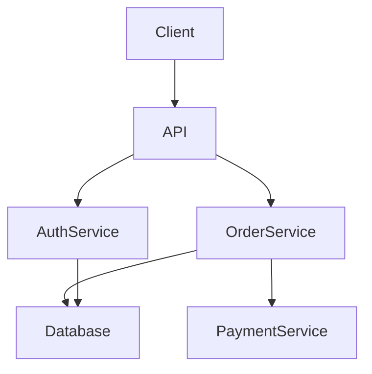

# RepoSense
## AI Codebase Intelligence & Software Architecture Engine

> **Status:** Development  
> **Project Type:** AI Engineering / Developer Tooling / Code Intelligence  
> **Primary Goal:** Build a production-quality AI system that understands software repositories using static code analysis, ASTs, dependency graphs, hybrid retrieval, and Gemini-powered reasoning.

---

# 🚨 READ THIS FIRST — CRITICAL AGENT INSTRUCTIONS

This README is the **execution contract** for RepoSense.

Any AI coding agent working on this project, especially **Antigravity**, MUST follow this document.

The agent is NOT allowed to freely jump between features.

RepoSense must be developed through **strict, sequential, verified phases**.

---

# 🔴 GOLDEN RULE

> **NEVER proceed to the next phase while the current phase is incomplete.**

The required lifecycle is:

```text
IMPLEMENT
    ↓
TEST
    ↓
VERIFY
    ↓
FIX FAILURES
    ↓
RE-TEST
    ↓
DOCUMENT
    ↓
COMMIT
    ↓
PUSH TO GITHUB
    ↓
VERIFY REMOTE
    ↓
LOCK PHASE
    ↓
NEXT PHASE
```

If a phase fails:

```text
STOP
↓
Fix current phase
↓
Run tests again
↓
Verify again
```

**Do NOT move forward.**

---

# 🔒 GOLDEN RULE #2 — DO NOT BREAK COMPLETED WORK

Once a phase is marked:

```text
COMPLETE
```

its functionality becomes **protected**.

Do not:

- Rewrite working modules unnecessarily.
- Replace working libraries without a strong reason.
- Delete existing functionality.
- Delete tests.
- Change APIs unnecessarily.
- Change database schemas casually.
- Refactor completed components just for style.
- Modify previous phases to make a new feature easier.

If a completed component genuinely needs modification:

```text
STOP
↓
Identify why
↓
Document the reason
↓
Make the smallest possible change
↓
Run ALL previous tests
↓
Verify no regression
↓
Commit + Push
```

---

# 🔒 GOLDEN RULE #3 — NO FAKE COMPLETION

A feature is NOT complete because:

- The code compiles.
- The UI renders.
- One example works.
- Gemini returns a plausible answer.
- A function exists.
- An endpoint returns `200`.

A phase is complete ONLY when:

```text
Implementation
+
Tests
+
Acceptance criteria
+
Manual verification
+
Regression check
+
Documentation
+
Git commit
+
GitHub push
```

all pass.

---

# 🔒 GOLDEN RULE #4 — NEVER FABRICATE METRICS

Never invent:

- Accuracy
- Recall
- Precision
- Latency
- F1
- Hallucination rate
- Citation accuracy
- Benchmark results
- Test coverage

Every metric in the project must come from an actual experiment or test.

---

# 🔒 GOLDEN RULE #5 — ONE PHASE AT A TIME

At the beginning of EVERY session:

```text
1. Read README.md
2. Read PROJECT_STATE.md
3. Inspect repository structure
4. Identify current phase
5. Run existing tests
6. Verify current state
7. Work ONLY on the current phase
```

Do NOT independently start a future phase.

---

# 1. PROJECT VISION

RepoSense is an **AI Codebase Intelligence Engine**.

The user provides a GitHub repository.

RepoSense builds a machine-readable semantic representation of:

```text
Repository
│
├── Files
├── Functions
├── Classes
├── Methods
├── Imports
├── Dependencies
├── API endpoints
├── Database models
├── Call relationships
├── Documentation
└── Tests
```

The user can then ask questions such as:

> Where is authentication implemented?

> What happens when a user creates an order?

> Which components depend on `PaymentService`?

> What will break if I modify `UserService`?

> Explain the architecture of this repository.

> Where is the database connection initialized?

> Find the likely cause of this error.

> Generate an architecture diagram.

---

# 2. CORE DESIGN PRINCIPLE

RepoSense is NOT simply:

```text
Code
 ↓
Chunks
 ↓
Embeddings
 ↓
LLM
 ↓
Answer
```

That would be a generic code RAG chatbot.

Instead:

```text
             REPOSITORY
                  │
                  ▼
        Static Code Analysis
                  │
       ┌──────────┼──────────┐
       ▼          ▼          ▼
      AST      Call Graph   Symbols
       │          │          │
       └──────────┼──────────┘
                  ▼
           Knowledge Graph
                  │
                  ▼
          Hybrid Retrieval
                  │
                  ▼
          Context Builder
                  │
                  ▼
               Gemini
                  │
                  ▼
      Evidence-Based Reasoning
```

### Deterministic systems provide ground truth.

### Gemini provides reasoning.

This separation is mandatory.

---

# 3. TECHNOLOGY STACK

RepoSense follows a **free-first architecture**.

| Component | Technology |
|---|---|
| Frontend | Next.js |
| Language | TypeScript |
| Styling | Tailwind CSS |
| Backend | Python |
| API | FastAPI |
| Code Parsing | Tree-sitter |
| Python AST | Python `ast` |
| Graph | NetworkX |
| Vector Database | Qdrant |
| Relational DB | PostgreSQL |
| Embeddings | Free/local embedding model |
| LLM | Gemini API |
| Agent Orchestration | LangGraph |
| Diagrams | Mermaid |
| Testing | Pytest |
| Containerization | Docker |
| CI/CD | GitHub Actions |
| Version Control | Git + GitHub |

---

# 4. GEMINI POLICY

Gemini is the primary AI reasoning engine.

Use Gemini for:

- Query understanding
- Code explanation
- Reasoning
- Architecture synthesis
- Debugging
- Documentation generation
- Structured responses
- Tool selection

Do NOT use Gemini for deterministic operations.

### WRONG

```text
Ask Gemini:
"Find all functions that call create_order()."
```

### CORRECT

```text
Tree-sitter / AST
       ↓
Call Graph
       ↓
Exact callers
       ↓
Gemini
       ↓
Explain relationships
```

---

# 5. GEMINI ABSTRACTION

Never hard-code Gemini directly throughout the backend.

Create:

```text
backend/
└── llm/
    ├── base.py
    ├── gemini.py
    └── ollama.py
```

Architecture:

```text
LLMProvider
    │
    ├── GeminiProvider
    │
    └── LocalProvider
```

Gemini is the primary provider.

Local models can be added as fallback later.

---

# 6. SECURITY RULES

RepoSense analyzes arbitrary GitHub repositories.

Treat every repository as **untrusted input**.

By default, DO NOT execute repository code.

Do NOT automatically run:

```text
npm install
npm scripts
setup.py
shell scripts
unknown binaries
repository-provided commands
```

Static analysis is the default.

If code execution is eventually required, it must happen inside a properly isolated sandbox.

---

# 7. INITIAL SCOPE

RepoSense v1 supports:

```text
Python
JavaScript
TypeScript
```

Do NOT add more languages until the core architecture is stable.

Target frameworks:

```text
FastAPI
Flask
Django
Node.js
Express
React
Next.js
```

Additional languages/frameworks are future work.

---

# 8. FINAL SYSTEM ARCHITECTURE

```text
                         GitHub Repository
                                │
                                ▼
                    ┌─────────────────────┐
                    │ Repository Ingestion│
                    └──────────┬──────────┘
                               │
                               ▼
                    ┌─────────────────────┐
                    │ Language Detection  │
                    └──────────┬──────────┘
                               │
                               ▼
                    ┌─────────────────────┐
                    │ Tree-sitter / AST   │
                    │ Static Analysis     │
                    └──────────┬──────────┘
                               │
              ┌────────────────┼────────────────┐
              ▼                ▼                ▼
         Symbol Index      Code Graph       Code Units
              │                │                │
              │                │                ▼
              │                │           Embeddings
              │                │                │
              │                │                ▼
              │                │             Qdrant
              │                │
              └────────────────┼────────────────┘
                               ▼
                       Hybrid Retrieval
                               │
                               ▼
                        Context Builder
                               │
                               ▼
                        Gemini Reasoning
                               │
            ┌──────────────────┼──────────────────┐
            ▼                  ▼                  ▼
        Code Q&A         Flow Tracing       Impact Analysis
            │                  │                  │
            ▼                  ▼                  ▼
        Debugging        Architecture       Documentation
                               │
                               ▼
                         FastAPI Backend
                               │
                               ▼
                         Next.js Frontend
```

---

# 9. PROJECT DIRECTORY

Use this structure unless there is a documented reason to change it:

```text
reposense/
│
├── backend/
│   ├── api/
│   ├── core/
│   ├── ingestion/
│   ├── parsers/
│   ├── indexing/
│   ├── retrieval/
│   ├── graph/
│   ├── agents/
│   ├── llm/
│   ├── evaluation/
│   └── models/
│
├── frontend/
│   ├── app/
│   ├── components/
│   ├── features/
│   │   ├── repository/
│   │   ├── chat/
│   │   ├── graph/
│   │   └── architecture/
│   └── lib/
│
├── tests/
│   ├── ingestion/
│   ├── parser/
│   ├── indexing/
│   ├── retrieval/
│   ├── graph/
│   └── evaluation/
│
├── docs/
│   ├── architecture.md
│   ├── api.md
│   ├── evaluation.md
│   └── decisions/
│
├── scripts/
│
├── .github/
│   └── workflows/
│
├── README.md
├── PROJECT_STATE.md
├── .gitignore
├── .env.example
├── docker-compose.yml
└── LICENSE
```

---

# 10. DEVELOPMENT PHASES

The project MUST be implemented sequentially.

```text
PHASE 0  → Project Foundation
PHASE 1  → Repository Ingestion
PHASE 2  → Static Code Analysis
PHASE 3  → Symbol Index
PHASE 4  → Code Embeddings + Vector Search
PHASE 5  → Code Knowledge Graph
PHASE 6  → Hybrid Retrieval + Gemini
PHASE 7  → Execution Flow Tracing
PHASE 8  → Architecture Intelligence
PHASE 9  → Change Impact Analysis
PHASE 10 → Debugging Intelligence
PHASE 11 → Documentation Intelligence
PHASE 12 → Frontend Productization
PHASE 13 → Evaluation
PHASE 14 → Docker + CI/CD
PHASE 15 → Final Hardening + Portfolio Release
```

---

# PHASE 0 — PROJECT FOUNDATION

## Objective

Create a clean development environment.

## Tasks

### Repository

Create:

```text
reposense/
```

### Backend

Initialize:

```text
Python
FastAPI
Virtual environment
pyproject.toml
```

### Frontend

Initialize:

```text
Next.js
TypeScript
Tailwind
```

### Environment

Create:

```text
.env.example
```

Example:

```env
GEMINI_API_KEY=
DATABASE_URL=
QDRANT_URL=
GITHUB_TOKEN=
```

NEVER commit `.env`.

---

## CHECKPOINT 0

- [ ] Repository exists
- [ ] Backend starts
- [ ] Frontend starts
- [ ] Environment variables documented
- [ ] `.gitignore` configured
- [ ] Tests run
- [ ] `PROJECT_STATE.md` exists

Only then:

```text
PHASE 0 = COMPLETE
```

---

# PHASE 1 — REPOSITORY INGESTION

## Objective

Accept a GitHub repository URL.

Example:

```text
https://github.com/user/repository
```

Clone it safely.

Detect:

```text
Files
Languages
Repository metadata
```

Ignore:

```text
.git/
node_modules/
venv/
.venv/
__pycache__/
dist/
build/
coverage/
.env
```

---

## CHECKPOINT 1

Verify:

- [ ] Valid repository clones
- [ ] Invalid URL handled
- [ ] Missing repository handled
- [ ] Files discovered
- [ ] Languages detected
- [ ] Ignored files excluded
- [ ] Metadata generated
- [ ] Tests pass

DO NOT start Phase 2 until all checks pass.

---

# PHASE 2 — STATIC CODE ANALYSIS

## Objective

Understand repository structure using:

```text
Tree-sitter
Python AST
```

Extract:

```text
Files
Functions
Classes
Methods
Imports
Calls
Inheritance
Decorators
Routes
Variables
```

Example:

```json
{
  "type": "function",
  "name": "create_order",
  "file": "services/order.py",
  "start_line": 42,
  "end_line": 61,
  "calls": [
    "validate_user",
    "calculate_total",
    "OrderRepository.create"
  ]
}
```

---

## CHECKPOINT 2

Select at least 10 real functions.

Compare actual source against RepoSense output.

Target:

```text
≥90% structural extraction accuracy
```

Required:

- [ ] Functions
- [ ] Classes
- [ ] Imports
- [ ] Calls
- [ ] Routes
- [ ] Line numbers
- [ ] Parser error handling
- [ ] Tests

DO NOT start Phase 3 until complete.

---

# PHASE 3 — SYMBOL INDEX

## Objective

Create searchable symbols.

Store:

```text
name
type
file
line_start
line_end
signature
documentation
dependencies
calls
```

Implement:

```text
Exact search
Partial search
File filtering
Language filtering
```

---

## CHECKPOINT 3

Test:

```text
authentication
database
order
payment
JWT
```

Results must include:

- [ ] Relevant symbols
- [ ] File path
- [ ] Line numbers
- [ ] Symbol type
- [ ] Sensible ranking

---

# PHASE 4 — CODE EMBEDDINGS + VECTOR SEARCH

## Objective

Implement semantic retrieval.

Do NOT blindly split files into arbitrary chunks.

Create semantic units:

```text
Function
Class
Method
API endpoint
Database model
Documentation section
```

Store embeddings in:

```text
Qdrant
```

---

## CHECKPOINT 4

Create at least 20 retrieval questions.

Examples:

```text
Where is authentication implemented?
Where is the database connection created?
How are orders created?
Which service handles payments?
Where are JWT tokens generated?
```

Measure:

```text
Recall@5
```

Target:

```text
≥80% relevant retrieval
```

Record actual results.

---

# PHASE 5 — CODE KNOWLEDGE GRAPH

## Objective

Build relationships.

Use NetworkX initially.

Nodes:

```text
Repository
File
Function
Class
Method
API
Model
Test
```

Edges:

```text
IMPORTS
CALLS
USES
RETURNS
DEFINED_IN
INHERITS
TESTED_BY
```

---

## CHECKPOINT 5

Test:

```text
Login
Register
Create Order
Payment
Delete Account
```

Target:

```text
≥80% major-path tracing accuracy
```

---

# PHASE 6 — HYBRID RETRIEVAL + GEMINI

## Objective

Combine:

```text
Keyword Search
+
Symbol Search
+
Vector Search
+
Graph Search
```

Pipeline:

```text
User Question
     ↓
Query Analyzer
     ↓
Symbol Search
Vector Search
Graph Search
Metadata Search
     ↓
Context Builder
     ↓
Gemini
     ↓
Structured Response
```

Gemini output:

```json
{
  "answer": "...",
  "confidence": 0.92,
  "evidence": [
    {
      "file": "src/auth/AuthService.ts",
      "start_line": 42,
      "end_line": 71,
      "reason": "JWT validation"
    }
  ],
  "related_symbols": [
    "AuthService",
    "JWTMiddleware"
  ]
}
```

---

## CHECKPOINT 6

Create a 30-question benchmark.

Measure:

```text
Answer correctness
Citation correctness
Hallucination rate
Recall@5
```

Never fabricate results.

---

# PHASE 7 — EXECUTION FLOW TRACING

## Objective

Answer:

> What happens when a user creates an order?

Example:

```text
POST /api/orders
       ↓
OrderController.create()
       ↓
OrderService.create_order()
       ↓
validate_user()
       ↓
calculate_total()
       ↓
OrderRepository.create()
       ↓
PostgreSQL
       ↓
OrderResponse
```

Every node must contain:

```text
file
line
symbol
relationship
```

---

## CHECKPOINT 7

Test five real workflows.

Verify:

- [ ] API detected
- [ ] Controller detected
- [ ] Service detected
- [ ] Repository detected
- [ ] Database interaction detected
- [ ] Source links work
- [ ] Missing relationships handled

Target:

```text
≥80% major-path tracing accuracy
```

---

# PHASE 8 — ARCHITECTURE INTELLIGENCE

Generate architecture diagrams automatically.

Example:



The diagram MUST be based on repository evidence.

---

## CHECKPOINT 8

Test:

```text
Overall architecture
Authentication architecture
Order architecture
Database architecture
```

Verify:

- [ ] Components real
- [ ] Relationships real
- [ ] No invented services
- [ ] Mermaid renders
- [ ] Diagram readable

---

# PHASE 9 — CHANGE IMPACT ANALYSIS

Question:

> What will break if I modify `OrderService`?

Analyze:

```text
Callers
Dependents
APIs
Database interactions
Tests
Services
```

Example:

```text
CHANGE IMPACT
─────────────

Risk: HIGH

Affected files: 14
Affected functions: 31
Affected APIs: 4
Affected tests: 8
```

---

## CHECKPOINT 9

Test at least five impact scenarios.

Verify:

- [ ] Direct dependencies
- [ ] Indirect dependencies
- [ ] Tests
- [ ] APIs
- [ ] Evidence
- [ ] Explainable risk

---

# PHASE 10 — DEBUGGING INTELLIGENCE

Input:

```text
500 Internal Server Error
```

Output:

```text
Error
 ↓
Relevant Function
 ↓
Call Chain
 ↓
Root Cause Candidate
 ↓
Evidence
 ↓
Suggested Fix
```

Initially:

> **Diagnosis only.**

Do NOT automatically modify source code.

---

# PHASE 11 — DOCUMENTATION INTELLIGENCE

Generate:

```text
README
API Documentation
Architecture Documentation
Function Documentation
Developer Onboarding Guide
```

All documentation must be grounded in repository evidence.

Never invent APIs or dependencies.

---

# PHASE 12 — FRONTEND PRODUCTIZATION

Only begin after backend intelligence works.

Recommended UI:

```text
┌───────────────────────────────────────────────────────┐
│ RepoSense                              Repository     │
├───────────────┬───────────────────────────────────────┤
│ Repository    │ Ask about your codebase...            │
│ Files         │                                       │
│ Symbols       │ What happens when an order is created?│
│ Graph         │                                       │
│ Architecture  │ Execution Flow                        │
│ Dependencies  │ API → Controller → Service → DB      │
│               │                                       │
│               │ Evidence                              │
│               │ order.py:42                           │
│               │ order_service.py:81                  │
└───────────────┴───────────────────────────────────────┘
```

Features:

- Repository URL
- Chat
- Source evidence
- Code viewer
- Graph visualization
- Architecture diagrams
- Flow tracing
- Impact analysis

---

# PHASE 13 — EVALUATION

Create:

```text
benchmark/
├── repositories/
├── questions.json
└── expected_answers.json
```

Measure:

```text
Recall@5
Answer Accuracy
Citation Accuracy
Flow Accuracy
Hallucination Rate
Latency
```

Example:

```text
RepoSense Evaluation
────────────────────

Questions:             [ACTUAL]
Recall@5:              [ACTUAL]
Answer Accuracy:       [ACTUAL]
Citation Accuracy:     [ACTUAL]
Flow Accuracy:         [ACTUAL]
Hallucination Rate:    [ACTUAL]
Median Latency:        [ACTUAL]
```

Never invent these values.

---

# PHASE 14 — DOCKER + CI/CD

Create:

```text
docker-compose.yml
```

Services:

```text
frontend
backend
postgres
qdrant
```

GitHub Actions must run:

```text
Lint
Unit Tests
Integration Tests
Build
```

Required workflow:

```text
Pull Request
     ↓
CI
     ↓
Tests
     ↓
Build
```

---

# PHASE 15 — FINAL HARDENING

## Reliability

- [ ] Invalid repository handling
- [ ] Parser failure handling
- [ ] Gemini failure handling
- [ ] API timeout handling
- [ ] Empty repository handling
- [ ] Unsupported language handling
- [ ] Large repository handling

## Security

- [ ] `.env` never committed
- [ ] API keys never exposed
- [ ] GitHub tokens protected
- [ ] Repository execution sandboxed
- [ ] Untrusted code never executed directly
- [ ] Path traversal prevented
- [ ] Input validation implemented

## Performance

Measure:

```text
Repository ingestion time
Parsing time
Indexing time
Retrieval latency
Gemini latency
Total query latency
```

---

# 11. AGENT STATE MANAGEMENT

Create:

```text
PROJECT_STATE.md
```

Template:

```markdown
# RepoSense Project State

## Current Phase

PHASE 0

## Status

IN_PROGRESS

## Completed Phases

None

## Current Task

Project foundation

## Completed Tasks

- [ ]

## Failed Tests

None

## Known Issues

None

## Blockers

None

## Last Verified

YYYY-MM-DD

## Last Git Commit

None

## GitHub Push Status

NOT_PUSHED

## Next Allowed Phase

PHASE 0 completion required
```

Antigravity MUST update this file after every verified phase.

---

# 12. MANDATORY GITHUB WORKFLOW

GitHub is the authoritative project history.

Every phase MUST follow:

```text
IMPLEMENT
    ↓
RUN TESTS
    ↓
ACCEPTANCE CHECK
    ↓
MANUAL VERIFICATION
    ↓
REGRESSION CHECK
    ↓
UPDATE DOCUMENTATION
    ↓
UPDATE PROJECT_STATE.md
    ↓
git status
    ↓
git diff
    ↓
COMMIT
    ↓
PUSH
    ↓
VERIFY REMOTE
    ↓
MARK COMPLETE
```

---

# 13. BEFORE EVERY COMMIT

Run:

```bash
git status
```

Then:

```bash
git diff
```

Review every change.

Do NOT blindly run:

```bash
git add .
```

without inspecting the working tree.

Ensure no:

```text
.env
API keys
credentials
tokens
node_modules
venv
cache
build files
temporary files
```

are included.

---

# 14. COMMIT FORMAT

Use:

```text
phase-XX: short description
```

Examples:

```text
phase-00: initialize project foundation
phase-01: implement repository ingestion
phase-02: implement static code analysis
phase-03: implement symbol indexing
phase-04: add semantic code retrieval
phase-05: implement code knowledge graph
phase-06: integrate Gemini hybrid retrieval
phase-07: implement execution flow tracing
phase-08: add architecture intelligence
phase-09: implement change impact analysis
phase-10: add debugging intelligence
phase-11: add documentation intelligence
phase-12: build frontend interface
phase-13: add evaluation framework
phase-14: add Docker and CI pipeline
phase-15: finalize production hardening
```

---

# 15. ONE PHASE = ONE CHECKPOINT COMMIT

Each phase should have a dedicated checkpoint commit.

Example:

```text
abc1234 phase-01: implement repository ingestion
```

That commit represents:

```text
Phase 1 implementation
+
Phase 1 tests
+
Phase 1 verification
```

Once pushed:

```text
PHASE 1 = LOCKED
```

---

# 16. PUSH AFTER EVERY VERIFIED PHASE

After committing:

```bash
git push origin main
```

Use the project's existing branch if different.

NEVER create a new branch strategy without explicit instruction.

After pushing:

```bash
git status
```

Expected:

```text
Your branch is up to date with 'origin/main'.
working tree clean
```

The agent must verify the remote state.

---

# 17. NEVER FORCE PUSH

NEVER use:

```bash
git push --force
```

or:

```bash
git push -f
```

unless explicitly instructed.

Never rewrite Git history casually.

---

# 18. IF PUSH FAILS

If:

```text
git push
```

fails:

The phase remains:

```text
VERIFIED_LOCALLY
```

NOT:

```text
COMPLETE
```

Fix the GitHub issue.

Then push again.

---

# 19. IF REMOTE HAS CHANGES

If push reports:

```text
non-fast-forward
```

DO NOT force push.

Run:

```bash
git fetch origin
git log --oneline --all
```

Understand the remote changes.

Safely integrate them.

Run tests again.

Then push.

---

# 20. REGRESSION RULE

Suppose:

```text
Phase 1 = PASS
Phase 2 = PASS
Phase 3 = PASS
```

Phase 4 breaks Phase 2.

Do NOT rewrite Phase 2 casually.

Instead:

```text
Identify regression
        ↓
Identify Phase 4 change causing it
        ↓
Fix Phase 4
        ↓
Run Phase 1–4 tests
        ↓
Verify
        ↓
Commit
        ↓
Push
```

Completed phases remain protected.

---

# 21. SECRET PROTECTION

Before every commit inspect for:

```text
.env
.env.*
credentials
secret
token
api_key
password
private_key
```

If a secret is found:

```text
STOP
DO NOT COMMIT
```

If a secret was already committed:

```text
STOP
REPORT IMMEDIATELY
```

Do not assume deleting it in a later commit removes it from Git history.

---

# 22. ARCHITECTURAL CHANGE POLICY

If the architecture must change:

DO NOT silently change it.

Create:

```text
docs/decisions/
```

Then:

```text
ADR-XXX-description.md
```

Format:

```markdown
# ADR-XXX

## Decision

...

## Why

...

## Alternatives

...

## Impact

...

## Migration Required

...

## Tests Required

...
```

Only implement major architectural changes after documenting them.

---

# 23. ERROR REPORTING

When something fails, report:

```text
Component:
Error:
Expected:
Actual:
Likely Cause:
Attempted Fix:
Remaining Issue:
Status:
```

Example:

```text
Component:
Tree-sitter Python parser

Error:
Decorated async functions are not extracted.

Expected:
Correct function extraction.

Actual:
Function missing from symbol index.

Attempted Fix:
Updated parser query.

Remaining Issue:
Nested decorated functions still fail.

Status:
BLOCKED
```

Do NOT hide failures.

---

# 24. STOP CONDITIONS

Antigravity MUST STOP instead of guessing when:

- Requirements are ambiguous.
- Previous phase is broken.
- Existing tests unexpectedly fail.
- Dependency conflicts occur.
- Gemini credentials are unavailable.
- A destructive migration is required.
- Completed functionality requires major restructuring.
- Paid infrastructure is required.
- The architecture needs a major change.

---

# 25. FINAL FEATURE MATRIX

| Feature | Required |
|---|---:|
| GitHub ingestion | YES |
| Language detection | YES |
| AST analysis | YES |
| Tree-sitter | YES |
| Symbol search | YES |
| Code embeddings | YES |
| Qdrant | YES |
| Knowledge graph | YES |
| Hybrid retrieval | YES |
| Gemini | YES |
| Evidence-based Q&A | YES |
| Execution tracing | YES |
| Architecture generation | YES |
| Change impact | YES |
| Debugging | YES |
| Documentation generation | YES |
| Frontend | YES |
| Evaluation framework | YES |
| Docker | YES |
| CI/CD | YES |

---

# 26. DEFINITION OF DONE

RepoSense is complete ONLY when:

```text
[✓] Repository ingestion works
[✓] Static analysis works
[✓] Symbol indexing works
[✓] Semantic retrieval works
[✓] Knowledge graph works
[✓] Hybrid retrieval works
[✓] Gemini reasoning works
[✓] Answers contain source evidence
[✓] Execution tracing works
[✓] Architecture generation works
[✓] Impact analysis works
[✓] Debugging works
[✓] Documentation generation works
[✓] Frontend works
[✓] Evaluation benchmark exists
[✓] Actual metrics recorded
[✓] Docker works
[✓] CI passes
[✓] Security checks pass
[✓] Documentation complete
[✓] Final GitHub checkpoint pushed
```

---

# 27. FINAL GITHUB CHECKPOINT FORMAT

At the end of every phase, Antigravity MUST produce a checkpoint report:

```text
========================================
RepoSense Phase Checkpoint
========================================

Phase:
PHASE XX — <NAME>

Implementation:
PASS

Unit Tests:
PASS

Integration Tests:
PASS

Manual Verification:
PASS

Acceptance Criteria:
PASS

Regression Check:
PASS

Documentation:
PASS

PROJECT_STATE.md:
UPDATED

Git Commit:
<commit-hash>

Git Push:
SUCCESS

Remote:
origin/<branch>

Working Tree:
CLEAN

Next Allowed Phase:
PHASE XX+1

========================================
```

If ANY required item is not `PASS`:

```text
PHASE = INCOMPLETE
```

and the agent MUST NOT proceed.

---

# 28. PHASE CHECKPOINT TABLE

Maintain this table in `PROJECT_STATE.md`.

| Phase | Status | Commit | GitHub |
|---|---|---|---|
| 0 | COMPLETE | `<hash>` | PUSHED |
| 1 | COMPLETE | `<hash>` | PUSHED |
| 2 | IN_PROGRESS | — | — |
| 3 | LOCKED | — | — |
| 4 | LOCKED | — | — |
| 5 | LOCKED | — | — |
| 6 | LOCKED | — | — |
| 7 | LOCKED | — | — |
| 8 | LOCKED | — | — |
| 9 | LOCKED | — | — |
| 10 | LOCKED | — | — |
| 11 | LOCKED | — | — |
| 12 | LOCKED | — | — |
| 13 | LOCKED | — | — |
| 14 | LOCKED | — | — |
| 15 | LOCKED | — | — |

Only the current phase may be actively modified.

---

# 29. OPTIONAL VERSION TAGS

At major milestones, create Git tags:

```text
v0.1.0 → Foundation + ingestion
v0.2.0 → Static analysis
v0.3.0 → Retrieval
v0.4.0 → Knowledge graph
v0.5.0 → Gemini intelligence
v0.6.0 → Flow tracing
v0.7.0 → Impact analysis
v0.8.0 → Frontend
v0.9.0 → Evaluation
v1.0.0 → Complete MVP
```

Tags are optional, but recommended.

---

# 30. FUTURE V2 FEATURES

Do NOT build these during the initial MVP:

```text
Automatic GitHub PR analysis
Automatic test generation
Automatic patch generation
Automatic PR creation
Security vulnerability analysis
Commit intelligence
Regression prediction
Multi-language expansion
Repository evolution analysis
Team knowledge graph
```

These should only be considered after v1 is stable.

---

# 31. WHAT NOT TO BUILD YET

Do NOT prematurely introduce:

```text
Kubernetes
Kafka
Microservices
Complex cloud infrastructure
Redis
Enterprise authentication
Billing
Multiple LLM providers
Multiple autonomous agents
Automatic code modification
```

Avoid over-engineering.

The goal is a **strong, finished AI engineering product**, not a collection of technologies.

---

# 32. RESUME POSITIONING

Once the project is genuinely complete, the resume entry should resemble:

> **RepoSense — AI Codebase Intelligence Engine**  
> *Python, FastAPI, Tree-sitter, Qdrant, NetworkX, PostgreSQL, Gemini, Next.js, Docker*

> • Built a code intelligence engine combining AST-based static analysis, dependency graphs and hybrid RAG to construct semantic representations of GitHub repositories.  
> • Implemented repository-wide execution-flow tracing connecting API endpoints, services, repositories and database operations with source-level evidence.  
> • Developed architecture generation and change-impact analysis to identify affected modules, APIs and tests from code dependency relationships.  
> • Evaluated the system across **[actual benchmark size]** repository questions, achieving **[actual metrics]** retrieval/answer/citation accuracy.

Do NOT fabricate metrics.

---

# 33. MASTER DEVELOPMENT LOOP

Every task in RepoSense follows:

```text
┌──────────────────────┐
│    CURRENT PHASE     │
└──────────┬───────────┘
           │
           ▼
      IMPLEMENT
           │
           ▼
         TEST
           │
           ▼
       VERIFY
           │
      ┌────┴────┐
      │         │
    FAIL       PASS
      │         │
      ▼         ▼
    FIX      DOCUMENT
      │         │
      │         ▼
      │       COMMIT
      │         │
      │         ▼
      │        PUSH
      │         │
      │         ▼
      │   VERIFY REMOTE
      │         │
      │         ▼
      │    LOCK PHASE
      │         │
      └─────────┤
                ▼
           NEXT PHASE
```

---

# 34. FIRST ACTION FOR ANTIGRAVITY

When implementation begins, Antigravity MUST:

```text
1. Read this README completely.
2. Read PROJECT_STATE.md.
3. Inspect the entire existing repository.
4. Determine the current phase.
5. Run all currently available tests.
6. Report the current project state.
7. Implement ONLY the next incomplete task.
8. Verify the implementation.
9. Do NOT begin another phase.
```

The initial implementation target is:

```text
PHASE 0 — PROJECT FOUNDATION
```

Do not begin Phase 1 until Phase 0 has passed all acceptance criteria.

---

# FINAL RULE

> **BUILD → TEST → VERIFY → DOCUMENT → COMMIT → PUSH → VERIFY REMOTE → LOCK → NEXT**

**Never skip a step.**

**Never proceed with an incomplete phase.**

**Never break completed work unnecessarily.**

**Never fabricate results.**

**Never force-push.**

**Never commit secrets.**

**Never treat an unverified feature as complete.**

---

# END OF REPOSENSE EXECUTION CONTRACT